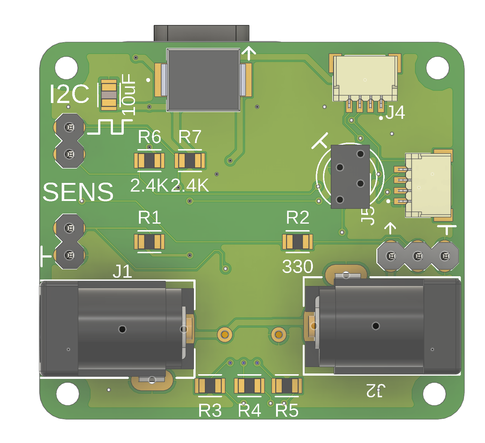
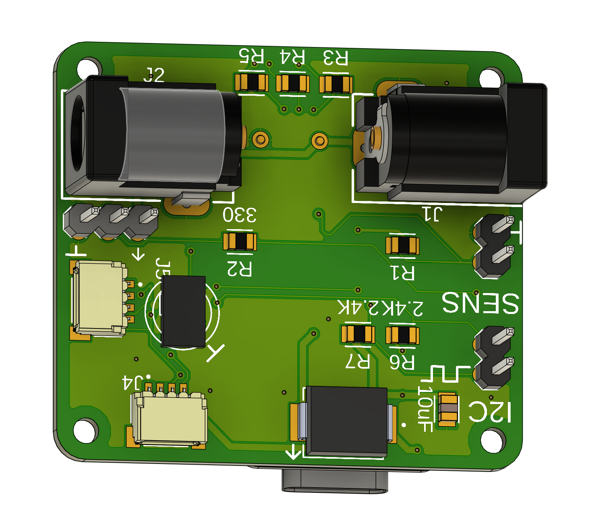

# SmartHome Monitor — An Expandable Environmental Sensing Platform

A custom PCB and firmware suite for indoor environmental monitoring, designed as a general-purpose base platform that scales from a single temperature/humidity node to a multi-modal sensing hub with expansion pathways for actuation and display.

<p align="center">
  
  
</p>

## Motivation

While quick and easy implementations of "one-off breadboard" working prototypes are able to quickly accomplish the task at hand, they often fail in the long term as they are not easy to expand upon and the use of the breadboard itself keeps the system a prototype instead of feeling like a complete product. This project aims to address this by creating custom hardware (PCB-level) to enable reconfigurability in functionality, with the explicit goal of producing a base platform reusable across future projects rather than a single-purpose device.

The design started from a working breadboard prototype using an Arduino Nano 33 IoT and a DHT11 streaming to Arduino Cloud. Three constraints motivated the redesign: the DHT11's ±2°C accuracy and 1°C resolution required elaborate software compensation to detect HVAC state transitions; the free Arduino Cloud tier limited retention and dashboarding to the point that Adafruit IO became preferable; and the breadboard form factor precluded permanent installation. The resulting board addresses all three while adding a documented expansion path for the sensing modalities and display peripherals I intend to add later.

## Repository structure

```
SmartHome-Monitor/
├── README.md                       — this file
├── LICENSE
├── CHANGELOG.md
├── .gitignore
├── docs/
│   ├── design-rationale.md         — component selection reasoning
│   ├── power-architecture.md       — dual-input power strategy
│   ├── assembly-guide.md           — hand-solder walkthrough
│   ├── enclosure-design.md         — 3D-printed housing with dovetail mount
│   └── images/                     — renders, schematics, photos
├── hardware/
│   ├── schematic.pdf               — full electrical schematic
│   ├── BOM.csv                     — bill of materials with sources
│   ├── pcb_images/                 — top/bottom PCB renders
│   └── enclosure/                  — STL files (WIP)
├── manufacturing/
│   ├── HomeTemp_PCB v12_2026-07-11.zip		— full PCB manufacturing files (copper, DRL, Silkscreen, etc)
├── collected-data/                — Adafruit IO export analysis (homesense package)
└── firmware/
    ├── secrets_example.h           — credential + per-board settings template
    ├── level1_basic_monitor/       — BME280 → Adafruit IO bring-up check
    ├── level2_room_sensor/         — multi-room firmware: living-room main + bedroom peripheral
    ├── level3_future_spotify_display/ — planned WS2812B album-art display
    └── dev_spotifyAPI/, dev_spotifyMCU/ — stepping stones toward Level 3
```

## Project tiers

The firmware is organized as progressive tiers, each a working sketch on the same PCB.

### Level 1 — Basic monitor

BME280 temperature and humidity published to Adafruit IO every 30 s. This is the "does the hardware work end-to-end" checkpoint. See [`firmware/level1_basic_monitor/`](firmware/level1_basic_monitor/).

### Level 2 — Multi-room room sensor

The deployed firmware. One sketch runs on every board, and a `DEVICE_ROLE` setting picks the board's job. The living-room **main** board adds a TSL2591 light sensor, split into lamp light and sunlight by its IR fraction, plus outdoor temperature from Open-Meteo. The bedroom **peripheral** board reads its BME280 only. Both boards publish independently and fit inside the Adafruit IO free tier together (9 of 10 feeds, well under 30 messages/min) by packing diagnostics into one text feed per board. See [`firmware/level2_room_sensor/`](firmware/level2_room_sensor/).

### Level 3 — Spotify album-art display (future work)

Reuses the same PCB with a WS2812B matrix on the 3-pin JST connector: OAuth 2.0 against Spotify's Web API, JPEG decode, and downsampling to the matrix. See [`firmware/level3_future_spotify_display/`](firmware/level3_future_spotify_display/).

### Data analysis

[`collected-data/`](collected-data/) turns Adafruit IO CSV exports into weekly dashboards, room comparisons, a passive thermal model of the apartment, board health, and a suggested light-sensor calibration.

## Hardware summary

| Attribute | Value |
|---|---|
| MCU | Seeed XIAO ESP32-C3 (RISC-V, 160 MHz, WiFi + BLE) |
| Sensors | BME280 temperature/humidity; TSL2591 light on the main board (both I2C via Qwiic) |
| Board dimensions | ~50 × 45 mm (2.25 in²) |
| Power inputs | Dual 5.5×2.1mm barrel jacks (5V logic, 5V matrix) |
| Expansion | 2× SparkFun Qwiic (JST-SH), 1× 3-pin JST-SM (WS2812B), 2-pin thermistor header, breadboard-friendly I2C THT pads |
| Enclosure | FDM-printed two-piece housing with dovetail wall mount |

Full component list, source, and rationale in [`hardware/BOM.csv`](hardware/BOM.csv) and [`docs/design-rationale.md`](docs/design-rationale.md).

## Getting started

1. Print the enclosure files from `hardware/enclosure/` — see [`docs/enclosure-design.md`](docs/enclosure-design.md) for orientation.
2. Order the PCB from Gerber files (not in this repo — export from your CAD tool of choice) and assemble per [`docs/assembly-guide.md`](docs/assembly-guide.md).
3. Connect a BME280 breakout (Adafruit or SparkFun Qwiic) to J3 or J4.
4. Copy `firmware/secrets_example.h` to `secrets.h` next to the sketch you are flashing and fill in your WiFi and Adafruit IO credentials. **This file is gitignored — never commit it.**
5. Open `firmware/level1_basic_monitor/level1_basic_monitor.ino` in Arduino IDE, select "XIAO_ESP32C3" as the board, upload.
6. Once Level 1 publishes, flash [Level 2](firmware/level2_room_sensor/) to each board with the right `DEVICE_ROLE`.

## Design decisions worth reading

Three choices deserve their own discussion, all documented separately:

- **Why the XIAO ESP32-C3 over the QT Py ESP32-S3.** See [`docs/design-rationale.md`](docs/design-rationale.md#mcu-selection). Short version: the C3's single-core RISC-V is sufficient for the sensing workload, and the ~$8 cost delta compounds across a repeat-build platform.
- **Why two barrel jacks instead of one.** See [`docs/power-architecture.md`](docs/power-architecture.md). Short version: isolating the WS2812B matrix's up-to-5A pulsed current draw from the sensor rail preserves analog measurement quality.
- **Why the enclosure uses a dovetail rather than screws.** See [`docs/enclosure-design.md`](docs/enclosure-design.md). Short version: one-handed removal for firmware iteration without disturbing the wall-mounted power/network connections.

## License

MIT. See [`LICENSE`](LICENSE).

## Author

Yash Patel. Firmware and hardware co-design.
